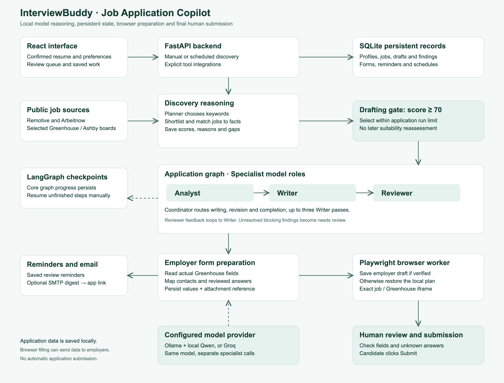
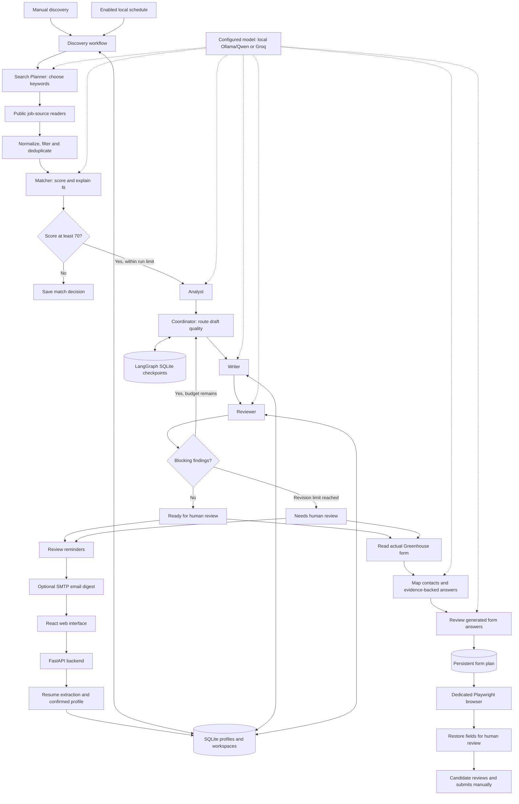

# InterviewBuddy — Week 3: Job Application Copilot

**Author:** Nikhila Mandapuram  
**Track:** Bring-your-own use case; code-heavy LangChain/LangGraph track  
**Code:** [InterviewBuddy on GitHub](https://github.com/NikhilaReddyM/InterviewBuddy)  
**Video demo:** [Add your final video link]  
**Google Doc:** [Add your final shared Google Doc link]

This document is ready to copy into the submission Google Doc. Replace the two link placeholders, review the first-person observations, and confirm that the GitHub repository contains the final changes and is accessible to reviewers.

## 1. Primer

My agent helps software engineers discover relevant jobs and prepare applications in the InterviewBuddy web app, replacing manual job-board searching, resume-to-role comparison, repeated writing and form entry; it uses public job-source readers, application-form readers, persistent workspaces, browser controls, reminders and email delivery to prepare applications autonomously, hands off unknown answers and final submission to the candidate, and has an initial target of producing one usable application for review in under ten minutes in at least eight out of ten evaluated cases.

**Measurement note:** Ten minutes and eight out of ten are proposed acceptance targets, not demonstrated results. I have not measured the time saved against a manual baseline or completed a ten-case evaluation. The live and synthetic observations below describe what has actually been tested.

## 2. Project overview

InterviewBuddy’s Week 3 feature is a job application copilot. A candidate uploads a PDF or DOCX resume, confirms an evidence-backed profile, and provides job preferences. The system discovers opportunities, scores their relevance, drafts application materials, checks claims, and prepares supported employer forms for later review.

A score of **70/100 or higher** is the final drafting gate. Selected jobs proceed in score order, within a configured limit of one to three applications per run. The drafting stage does not reconsider whether the candidate should apply; it focuses on creating supported materials and identifying unanswered questions.

The intended result is an application ready for human inspection: cover letter, resume suggestions, available screening answers, match reasoning, gaps, reminders, and a browser action that restores the supported employer form. I review the actual employer page and submit the application myself.

The Week 2 PDF study and cited Q&A features remain in the app, but they are separate from this Week 3 application workflow.

## 3. Agent framework

| Field | Implementation |
|---|---|
| Agent goal | Find relevant opportunities and prepare honest, reviewable applications using a confirmed candidate profile. Final submission remains with the candidate. |
| Where people use it | The InterviewBuddy React web interface on a local computer. A dedicated Chromium window provides the employer-form handoff; optional email digests link back to saved reviews. |
| Steps in order | Upload and confirm a profile; discover and shortlist jobs; score matches; analyze and draft selected applications; review and revise; prepare employer fields; create reminders; hand off for final review and submission. Discovery can start manually or from an enabled schedule. |
| Tools and actions | Read public job listings and form schemas; save workspaces and drafts; fill browser fields and upload the original resume; create review reminders; send an enabled email digest. Reads are autonomous; application preparation and notification writes follow configured authorization, while submission is always manual. |
| Memory | SQLite stores confirmed profiles, immutable profile snapshots, job listings, match decisions, draft versions, findings, form plans, reminders and schedules. LangGraph checkpoints preserve application-agent execution across interruptions. |
| Hard limits | Do not invent candidate qualifications, work authorization, salary preferences, consent or personal declarations. Do not click Submit/Apply/Continue, bypass verification, or claim that a link preserves a draft without evidence. |
| Human-in-the-loop | The candidate initially confirms the profile and contact details and configures schedules/email. The main discovery flow does not require approval at every stage; unknown answers, unresolved findings, verification and final submission are handed to the candidate. |
| Failure handling | Save completed work, show an actionable error and allow explicit recovery. Provider cooldowns do not cause repeated automatic retries; supported browser forms can be restored from locally saved answers after a restart. |
| Success measure | A usable application package and supported employer-form handoff within ten minutes in at least eight of ten labeled cases, with supported claims and unknown information left unanswered. This remains a target pending a broader evaluation. |

## 4. Architecture

Insert [this PNG diagram](assets/week3-architecture.png) into the Google Doc. The [SVG source](assets/week3-architecture.svg) is also available.

Editable Mermaid version

### Technology choices

| Layer | Technology and purpose |
|---|---|
| Interface | React, TypeScript and Vite for profiles, opportunities, workspaces and final review. |
| Backend | Python/FastAPI for local APIs, integrations and background coordination. |
| Stateful agent flow | LangGraph with SQLite checkpoints for the core application graph; LangChain integrations support structured model calls. |
| Model | Local `qwen3:8b` through Ollama for current validation; Groq remains an explicitly selectable alternative. Ollama uses its native structured-output API. |
| Validation | Pydantic schemas, source-ID validation, source-passage checks, reviewer findings and final human inspection. |
| Persistent data | SQLite plus local resume files and isolated browser-profile directories. Mem0 is not used. |
| Browser | Playwright/Chromium for supported Greenhouse fields and resume upload. |
| Notifications | Persisted review reminders and opt-in SMTP delivery; Gmail delivery was tested manually. |

These agents are specialist roles using the configured model, not separate continuously running model servers. Tools are explicit Python integrations invoked by the workflow. This is a bounded agentic workflow rather than an unrestricted browsing or self-modifying agent.

## 5. What makes the workflow agentic

The Search Planner chooses keywords from the profile and preferences. The backend reads a bounded set of public feeds, and those keywords help shortlist roles. The Matcher evaluates unfamiliar descriptions, explains relevance and identifies gaps. The Analyst maps job requirements to candidate facts, while the Writer tailors application content and the Reviewer checks the resulting claims.

Reviewer findings affect the next action. Blocking findings trigger revision, with up to three Writer passes. If blocking findings remain at the limit, the system preserves the drafts as **needs review** rather than continuing indefinitely. Missing candidate information is not treated as proof of disqualification.

For discovery-selected jobs, the Coordinator is deliberately deterministic: the match threshold already decided suitability, so it routes writing, revision and completion without another model-based acceptance decision. Scheduling, persistence, threshold enforcement and email delivery are conventional automation supporting the reasoning stages.

The system improves the current draft through feedback. It does not train Qwen, permanently learn from every user edit, or automatically change its own policies.

## 6. Data used

| Data | Source and use |
|---|---|
| Candidate resume | A user-provided PDF/DOCX. Text is extracted locally, and structured facts retain supporting resume passages for confirmation. |
| Preferences and contacts | User-confirmed target roles, locations, work arrangements, exclusions and form contact details. These are not inferred from missing resume information. |
| Job listings | Public Remotive and Arbeitnow feeds, plus selected Greenhouse and Ashby employer boards. Default employer boards include Datadog, MongoDB, Cloudflare, Ramp and Notion. Coverage is selective, not the entire web. |
| Application fields | The actual public Greenhouse schema for the selected job, including question labels, required flags, field types and options. |
| Test fixtures | Synthetic profiles, jobs, model outputs and browser forms for repeatable functional and recovery tests. |

No application-specific model training dataset was created. The resume and saved records are runtime context. Listing availability, location restrictions and eligibility still require final checking.

## 7. Prompts and instructions

### Representative AI coding requests

The following are examples from the development conversation:

> Can you implement scheduled discovery

> Also implement email digest

> I just want the information on when cooldown end to resume

> I want the agent to fill the application on the job site already, I just want the job application site link, for me to submit

> Can you make those changes please? Also, on Find Opportunities, polish the UI, it feels so crowded with so many runs now

These requests drove changes to the workflow, recovery policy, browser handoff and interface. Another key requirement was that jobs scoring at least 70 should be drafted without another suitability decision during drafting.

### Runtime agent instructions

The versioned source of the specialist prompts and response schemas is `backend/application_agents.py`; graph routing and validation are in `backend/agent_flow.py`. Representative instructions include:

> Job requirements are not candidate qualifications. Missing evidence means unknown, not an explicit lack of qualification.

> Every factual candidate claim must reference supporting source_ids.

> Flag unsupported candidate claims as blocking.

> Return null and no IDs for unknown answers.

Profiles, job descriptions and form text are treated as untrusted context. Structured schemas constrain response shape; code checks references and allowed actions. A valid JSON response or an existing fact ID alone does not prove that a claim is supported, which is why model review and final human inspection remain necessary.

## 8. Persistence, browser handoff and human control

Each application is associated with the confirmed profile version used to generate it. Profile changes can trigger a separate reassessment of saved listings without silently overwriting earlier drafts. Stable request IDs and SQLite constraints prevent replayed writes from creating duplicate workspaces, draft versions or reminders for the same operation.

The core graph checkpoints unfinished execution. Discovery separately saves its plan, shortlisted listings, completed matching groups and application progress. Form preparation saves field answers, choices, source references, attachment references and a schema fingerprint; stale edits are rejected without discarding the user’s unsaved text.

Employer-side saved drafts are used only after a recognizable save action, visible confirmation and supported resume link. Otherwise, the reliable handoff is the **Review application** action in InterviewBuddy: it opens the employer page and restores locally saved answers. An ordinary employer URL alone is not a saved application.

The candidate authorizes preparation through the workflow and configuration rather than approving every local write. Filling fields or uploading a resume can transmit information to the employer before submission. Reminders are governed by reminder preferences, email requires explicit enabling, and the final Submit action is always performed by the candidate.

Application schedules run only while the computer is awake and the backend and required local services are running. Changes made solely in the employer browser are not copied back into the saved plan; reusable edits should be saved in InterviewBuddy.

## 9. Iterations and learnings

| Problem encountered | Change made and lesson |
|---|---|
| Profile generation failed on supporting quotes | Switched to numbered source passages with backend-resolved evidence spans. Evidence should be validated, not entrusted to generated quote text. |
| Groq rate limits interrupted batches | Saved completed groups, exposed cooldown times and kept retry manual. Error recovery must preserve progress rather than restart the whole task. |
| The app still selected Groq after Ollama setup | Added explicit provider configuration and checked what the running backend reported. Configuration needs runtime visibility. |
| Strong matches were later rejected for missing evidence | Made 70/100 the final drafting gate and removed repeated suitability decisions from discovery drafting. Unknown information belongs in review cautions. |
| An internal request ID exceeded its input limit | Added deterministic bounded IDs while preserving deduplication and recovery behavior. Internal identifiers need validation too. |
| Invented screening questions blocked all drafting | Kept the supplied questions authoritative, discarded extras, and left missing or duplicate answers blank for review. |
| Text drafts did not satisfy the intended task | Added actual employer-field preparation, persistent form plans and a browser handoff. A useful intermediate output is not always completion of the user’s workflow. |
| MongoDB used a branded page with an embedded application | Located the exact Greenhouse job iframe and handled delayed loading, nullable API fields and hidden cover-letter controls. Live websites need adapter-level validation. |
| Many discovery runs made the page crowded | Added compact expandable runs, filters, search, pagination and grouped settings. Progress must be understandable to the person reviewing it later. |

The main learning was that useful agent behavior depends on state, controlled routing, recovery and a clear final handoff as much as on prompt quality.

## 10. Validation and observed results

| Evidence | Observation | What it establishes |
|---|---|---|
| Backend functional suite | **154 tests passed** in the latest full run. | Routing, persistence, threshold behavior, reference checks, recovery, deduplication and form-related functional behavior on test cases. |
| Frontend suite | **138 tests passed** in the latest recorded run. | UI behavior, editing, stale-save feedback and history filtering/pagination on test fixtures. |
| Build and lint | Production build and lint passed. | The app compiles and passes the configured lint checks. |
| Local Qwen diagnostic | Synthetic search planning: 1.95 seconds; profile extraction: 3.74 seconds; application graph: 20.18 seconds, three draft artifacts. Reopening retained the same run and draft count. | A small live-model diagnostic, not a real-profile latency benchmark or success-rate estimate. |
| Real Chromium fixture | Filled four synthetic controls: text, dropdown, attachment and expandable cover-letter text; submission count stayed zero. | Browser interaction worked on a controlled local form without submitting it. |
| Public MongoDB inspection | Verified the Greenhouse schema and live embedded controls without entering applicant information during the developer diagnostic. | The adapter could identify the supported employer form and relevant controls. |
| Manual application observation | During subsequent manual testing, I observed the MongoDB application being filled in the browser. | A user-observed live application-filling result. Complete field-by-field accuracy and end-to-end elapsed time were not formally scored. |
| Manual email observation | I confirmed email delivery worked after configuration and explicit retry. | Delivery worked for that manual test; unattended scheduled delivery is not a measured reliability benchmark. |

Automated tests predominantly use fixtures and mocked model boundaries. They do not demonstrate an 80% task-success rate or establish factual accuracy across applications. The Reviewer uses a separate role/prompt but may use the same underlying model as the Writer; it is not an independent evaluation ground truth.

A dedicated job-agent evaluation harness and dashboard have not been implemented. The existing retrieval and Ragas evaluation scripts belong to the earlier PDF Q&A feature and should not be presented as evaluations of these job applications.

### Proposed follow-up evaluation

Use ten manually labeled profile/job cases covering strong matches, scores below and at 70, missing skills, unsupported metrics, unknown screening answers and interrupted runs. Measure workflow completion, claim support, form-field correctness, unknown-answer handling, duplicate counts and end-to-end time; report failures separately. Keep development cases separate from held-out cases and record model and prompt versions.

## 11. Current limitations and privacy

- Browser filling currently supports Greenhouse; discovery coverage is broader than browser-filling coverage.
- Login, CAPTCHA, consent, personal declarations, unsupported controls and final submission may require manual work.
- Employer-side draft saving has not been established for MongoDB; its dependable handoff is local persistence and later restoration.
- The app does not submit applications automatically or infer submission status from the employer page.
- Local scheduling is not always-on cloud execution. The Mac and required services must remain available.
- A high match score is a model judgment, not a probability of getting hired or proof of eligibility. Reviewer approval also does not guarantee correctness.
- Local Ollama keeps inference requests on the computer; job discovery uses public internet sources, browser preparation sends information to the employer, and enabled email uses SMTP. Selecting Groq sends model context to that provider instead.
- Local data, browser profiles/cookies, resume files, credentials and private outputs must remain outside the shared code repository. Cloud tracing is disabled.

## 12. Use of AI coding tools

I used Codex to help design and implement the FastAPI/React changes, structured prompts and schemas, LangGraph flow, persistence, browser adapter, automated tests and documentation. I supplied the use case, refined the intended outcome, chose the 70-point policy and manual retry behavior, and manually tested the interface, email delivery and live application filling.

The implementation evolved through concrete failures rather than a single generated solution. I reviewed visible behavior and asked for changes when the process was confusing, overly restrictive, or stopped short of preparing the actual employer application. AI assistance accelerated implementation; it did not replace my responsibility to review the final outputs and explain the system’s limitations.

## 13. Demo and submission assets

The video must remain under five minutes. I plan approximately two minutes of narration, with time for UI interaction and browser loading:

1. Explain the candidate’s problem and show the confirmed profile/preferences.
2. Open the matched MongoDB role and show its score, drafts and review findings.
3. Use Review application to restore the employer form; show available filled fields and unanswered items, without clicking Submit.
4. Explain local Qwen, SQLite/LangGraph state, recovery, scheduling and the final human handoff.
5. Briefly describe Codex assistance, the main learning and current Greenhouse coverage.

If the demo restores an existing application, describe it as restoring saved work rather than a new discovery run. Conceal personal information and credentials in the recording. Useful screenshots include the architecture, match explanation, review package and restored employer form.

### Final preparation checklist

- [ ] Replace the Google Doc and video link placeholders above.
- [ ] Review this document for accuracy and add any personal learning or manual-review observations.
- [ ] Insert the supplied architecture PNG into the Google Doc; Mermaid source alone will not render there.
- [ ] Record the live result and AI-tool explanation in a video of five minutes or less.
- [ ] Push final code and confirm reviewer access to the GitHub repository.
- [ ] Verify no resume, `.env`, database, browser profile or private output is included in shared assets.
- [ ] Submit the Google Doc, video and code links through the [Week 3 submission form](https://forms.gle/waBYFkkf5xxmcouV9).

The supplied handout states a final certification deadline of **November 11, 2026** and an earlier Builder of the Week deadline of October 25, 2026. These dates are taken from that handout, not independently confirmed organizer updates. The handout allows an original use case; its Nebius wording is optional, and this document does not claim a Week 3 Nebius call.

## 14. Supporting implementation documentation

- [Application agent flow](application-agent-flow.md)
- [Persistent workspaces](application-workspaces.md)
- [Opportunity discovery](opportunity-discovery.md)
- [Broader job coverage](broader-job-coverage.md)
- [Review queue](application-review-queue.md)
- [Local model configuration](model-providers.md)
- [Scheduled discovery](scheduled-discovery.md)
- [Email digests](email-digest.md)
- [Employer form preparation and limitations](employer-application-forms.md)

The submission describes the current combined behavior. Earlier implementation notes may describe the behavior at the milestone when they were written.
